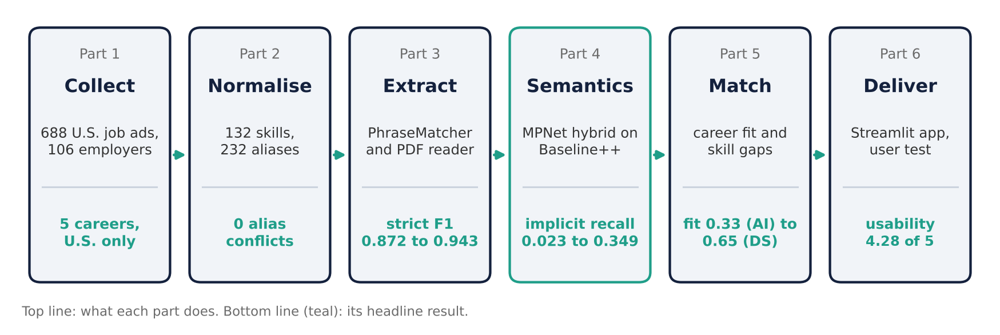
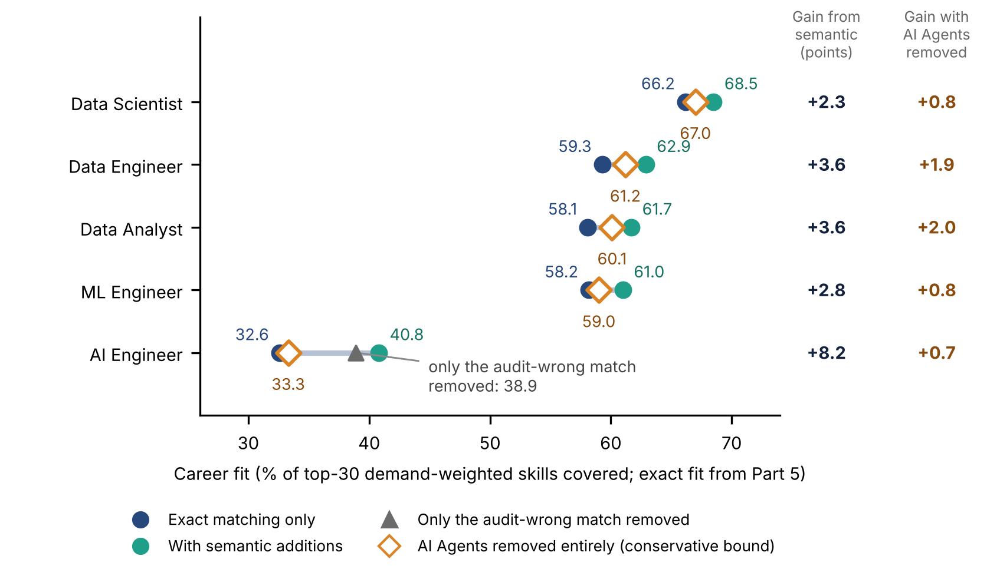
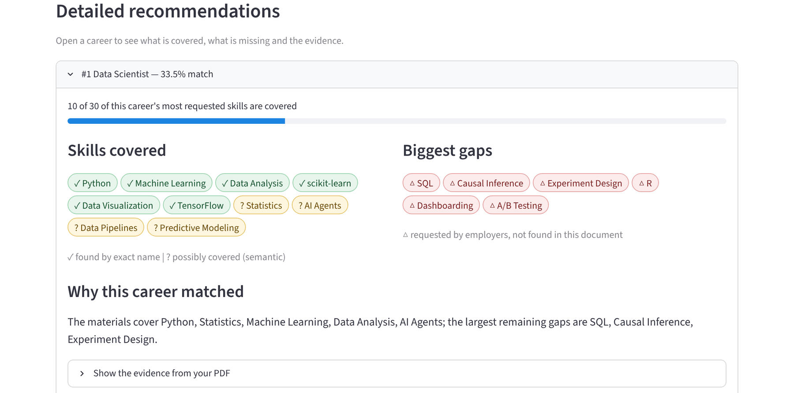

# From Study Materials to Career Recommendations

**UTS 36118 Applied NLP: Assessment 2 Part B, Group 6**

**Research question:** Are Australian university curricula aligned with the skills demanded by the U.S. Data/AI labour market?

We extract skills from Data/AI job advertisements (the U.S. benchmark) and from unit outlines (the study material) into one shared skill vocabulary, compare the two, and recommend careers and the skills to learn next. The final report is submitted separately and individually on Canvas.



## Headline results

* **Data:** 688 U.S. advertisements from 106 employers, five careers; 20 unit outlines from UTS, USYD and UNSW.
* **Extraction:** strict F1 rises from 0.872 (plain matcher) to 0.943 (Baseline++), mostly from the human-reviewed dictionary; the semantic layer lifts implicit-skill recall from 0.023 to 0.349 at about 64% precision on what it adds.
* **Alignment:** curriculum fit is highest for Data Scientist and lowest for AI Engineer (exact matching 65.4% and 32.6%; hybrid 68.5% and 40.8%). One hybrid match for AI Agents (USYD COMP5310) was judged false in the audit; without it AI Engineer is 38.9%, and with AI Agents removed entirely 33.3%, so its hybrid fit is best read as about 33 to 41%. Gaps are in applied, production-oriented skills (causal inference, experimentation, dbt, observability, APIs, agents).
* **Application:** upload a unit outline and get ranked career fits, covered skills, priority gaps and page-level evidence. A pilot test (n = 3) of the first version gave a mean rating of 4.40 out of 5 across all five questions; the interface was then revised (plain-language method names, sample button, "possibly covered" marking, tie warning, CSV download). The revised version has not been re-tested with users.



*Curriculum fit for each career (share of the 30 most demanded skills covered by the 20 units): exact matching, hybrid matching, only the audit-wrong AI Agents match removed, and AI Agents removed entirely (conservative bound). Exact values are the Part 5 figures, so Data Scientist shows 66.2% here (Part 3 reports 65.4%; Airflow and Time Series tie at rank 30), and every gain compares like with like.*


*The Streamlit application (exact mode, sample outline): upload a unit PDF and get ranked career matches, covered skills, gaps and evidence. Scores that are within two points are flagged as a tie.*



*Hybrid mode: skills found only by the semantic layer are marked "? possibly covered" so they can be checked against the evidence sentence (USYD COMP5310, from the saved hybrid output).*

## Repo layout

```
.
├── README.md                    this page
├── requirements.txt             shared libraries (every step folder also has its own)
├── Makefile                     shortcuts: make test, make app, make clean
├── run_app.command / .bat       one-click launchers for the app (Mac, Windows)
├── step1_data/                  raw and cleaned job ads, collection scripts, Australian set
├── step2_dictionary/            skills dictionary, taxonomy, normalisation module
├── step3_baseline_nlp/          extractors, PDF reader, alignment, notebooks 03 to 08
│   ├── annotation/              second-annotator check: sheets, labels, agreement scripts and results
│   ├── data/                    the 20 unit PDFs and their manifest
│   ├── docs/                    data sources, references, LLM-annotator provenance
│   ├── figures/                 report figures (300 dpi)
│   └── tests/                   40 tests
├── step4_semantic/              semantic layer, evaluation, blinded audits, results, tests, figures
├── step5_matching/              career matching, supplementary analyses, outputs, figures, tests
└── step6_app/                   Streamlit app, images, user-testing data
```

Every step folder has the same core: `README.md`, `requirements.txt`, the numbered notebook(s), the code, and its outputs or results. Step 3 keeps copies of the Step 1 and 2 inputs (`job_cleaned.csv`, `skills_dictionary.csv`, `normalisation.py`) so it runs on its own.

## Team and tasks

| Step | Member | Task | Folder |
|---|---|---|---|
| 1 | Zheke Yi | Collect and clean the job advertisements: 688 U.S. ads, five careers | `step1_data/` |
| 2 | Wancheng Liu | Build the skills dictionary: 132 skills, 232 aliases, 12 categories (the working vocabulary in Steps 3 to 5 has 158 skills after reviewed additions) | `step2_dictionary/` |
| 3 | Jirawan Pedersen | Baseline NLP, PDF reader, curriculum alignment, 20-unit case study, sector lens, gold sample and human agreement check | `step3_baseline_nlp/` |
| 4 | Tao Lou | Semantic layer (Sentence Transformers), main evaluation and blinded audits | `step4_semantic/` |
| 5 | Tengxiao Nong | Career profiles, matching scores, skill gaps and recommendations | `step5_matching/` |
| 6 | Chongyan Tang | Streamlit application and user testing | `step6_app/` |

## How to run

**Quickest way to open the app (no coding):** download or clone the repo, then double-click `run_app.command` (Mac) or `run_app.bat` (Windows). The first run installs what the app needs (a minute or two) and opens it in your browser. If double-clicking `run_app.command` does nothing on a Mac, open Terminal in the repo folder and run `bash run_app.command`. It offers an optional extra download (about 2 GB) for the deeper hybrid method; the fast method works without it.

To run everything (notebooks, tests), clone the repo and create an environment:

```
python -m venv .venv
source .venv/bin/activate        # Windows: .venv\Scripts\activate
pip install -r requirements.txt
jupyter lab
```

Then open a step folder and run its notebook with Restart & Run All. The quickest checks are:

* Tests: `cd step3_baseline_nlp && python -m pytest -q` (40), `cd step4_semantic && python -m pytest -q` (18), `cd step5_matching && python -m pytest -q` (6).
* Career ranking: `cd step5_matching && python matching.py`.
* App: double-click `run_app.command` (Mac) or `run_app.bat` (Windows), or run `pip install -r step6_app/requirements.txt` then `streamlit run step6_app/app.py`. A lighter install for the fast method only is `step6_app/requirements-light.txt`.
* Step 3 also has one-click launchers (`run.command` on Mac, `run.bat` on Windows). The Step 3 notebooks and `step5_matching/10_career_matching_colab.ipynb` are built for Google Colab: upload one, run the first cell, and follow the prompt.

## Where to find each part of the report

| Report section | Where in the repo |
|---|---|
| Data sources (job advertisements) | `step1_data/` (`job_cleaned.csv`, raw snapshot, collection script, `australia/`) |
| Data sources (unit documents) | `step3_baseline_nlp/data/curriculum_pdfs/` and `step3_baseline_nlp/docs/references_and_data_sources.md` |
| Skill vocabulary and normalisation | `step2_dictionary/` (`outputs/skills_dictionary.csv`, `outputs/normalisation.py`) |
| Baseline and Baseline++ extraction | `step3_baseline_nlp/skill_extractor.py`, `skill_extractor_v2.py`, `discover.py`, `extra_aliases_reviewed.csv` |
| Reading unit PDFs | `step3_baseline_nlp/extraction.py`, `curriculum.py` |
| Semantic layer | `step4_semantic/semantic_extractor.py`, `corpus_extract.py`, `curriculum_semantic.py` |
| Career matching and recommendations | `step5_matching/matching.py`, `frontend_api.py` |
| Evaluation, gold set and uncertainty | `step3_baseline_nlp/evaluate.py`, `gold_annotations.py`, `annotation/`; `step4_semantic/experiments.py`, `metrics.py` |
| Findings: extraction accuracy | `step3_baseline_nlp/04_innovation_experiments.ipynb`; `step4_semantic/results/summary.md` |
| Findings: curriculum alignment and sectors | `step3_baseline_nlp/06_curriculum_alignment.ipynb`, `07_sector_lens.ipynb`, `08_real_curriculum_case_study.ipynb`, `figures/` |
| Bootstrap gains, AI Agents check (including the false-match-only variant, `G_false_match_only.csv`), uncovered demand by category, greedy unit selection, top-N sensitivity (Table A2), audit precision (Figure 4) | `step5_matching/supplementary_analyses.py`, `11_supplementary_analyses.ipynb`, `step5_matching/outputs/supplementary/` |
| Findings: demand by career (Figure 3, Table 4) and fit gain figure (Figure 9) | `step5_matching/report_figures.py`, `outputs/supplementary/H_demand_exact.csv` |
| Findings: exact versus hybrid career fit | `step4_semantic/results/details/curriculum_fit_exact_vs_hybrid.csv`; `step5_matching/outputs/` |
| Blinded audits | `step4_semantic/results/audit/` |
| Application and user test | `step6_app/app.py`; `run_app.command` / `run_app.bat`; `step6_app/user_testing/` |
| Reproducibility | `requirements.txt` in every step; tests in Steps 3, 4 and 5 |

## Data and references

* Job ads: 688 public postings from 106 companies (Greenhouse and Ashby job boards), collected 1 Oct 2026. The 14 Australian ads are a separate, small set.
* Curriculum sources: 20 public unit pages (UTS, USYD, UNSW handbooks), saved as PDFs in `step3_baseline_nlp/data/curriculum_pdfs/` and listed with URLs and APA references in `step3_baseline_nlp/docs/references_and_data_sources.md`.

## Group limitations

* U.S.-only job data, mostly large tech employers and mostly 2026 ads. The Australian set is too small (14 ads) for separate tests.
* Twenty selected units is a case study, not all of Australian higher education or whole degrees.
* Gold labels come from a single LLM annotator. On 10 ads a human annotator agreed only fairly (Cohen's kappa 0.33, 95% CI 0.19 to 0.44, for named-and-demanded skills; 0.25 over four classes) and a second LLM pass agreed closely (0.85) but is not independent; implicit-skill labels are unreliable (kappa at most 0.12). See `step3_baseline_nlp/annotation/annotator_agreement_results.csv`.


## Use of AI tools

A large language model (Claude, Anthropic) was used as an annotator. It produced the gold labels for the 30-advertisement gold set (`step3_baseline_nlp/gold_annotations.py`) and a second labelling pass on 10 of those advertisements (`step3_baseline_nlp/annotation/llm_second_annotator_FILLED.xlsx`). The human labels on the same 10 advertisements are separate (`annotation/human_merged.xlsx`). All results, interpretations and conclusions were reviewed and written by Group 6.

## Reproducibility

* Automated tests: 40 (Step 3), 18 (Step 4), 6 (Step 5), all passing.
* Re-running `step1_data/01_data_cleaning.ipynb` reproduces the 688 cleaned advertisements exactly.
* Fixed random seed 36118 for the gold-set split and bootstrap intervals.
* Checked with Python 3.13, spaCy 3.8, pandas 3.0, NumPy 2.5, SciPy 1.18, PyMuPDF 1.28, sentence-transformers 6.1, PyTorch 2.14, Streamlit 1.65 and pytest 9.1.

## Run times

* Step 3 tests take under a minute; Steps 4 and 5 tests take a few seconds.
* `python matching.py` in Step 5 takes a few seconds and needs no model download.
* The first run of Step 4's model comparison, and the first use of hybrid mode in the app, downloads the language models (about 0.4 GB for the main model); allow roughly 10 to 30 minutes on a CPU for the full Step 4 run.
