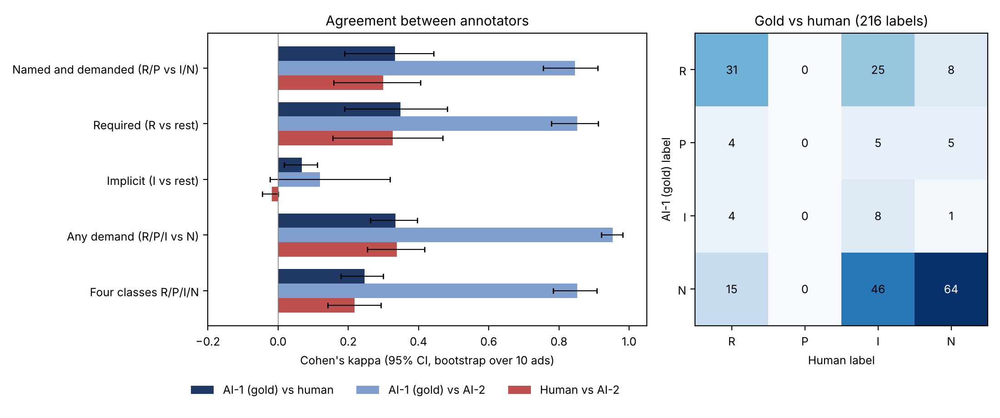

# Annotation agreement on the gold set: three raters, 10 advertisements

## Purpose
The extraction results in Steps 3 to 5 are scored against a 30-advertisement gold set labelled by one AI annotator. This note tests how far those labels can be trusted by comparing them with two other raters on 10 of the 30 advertisements.

## Method
Ten advertisements were drawn at random (seed 36118; ads of 7,000 characters or fewer). For each, the annotators labelled a candidate pool of skills: everything the extractor found, every skill in the gold set, and 12 random distractors. This gives 216 ad-skill pairs. Labels were R (required), P (preferred), I (implicit: the skill is not named but the concept is clearly demanded) and N (not demanded), as defined in the instructions sheet.

| Rater | Source | Notes |
|---|---|---|
| AI-1 (gold) | `gold_annotations.py`, key in `human_annotation_key_PRIVATE.csv` | Labelled blind to the extractor's output. |
| Human | `human_merged.xlsx` (pass 1 `human_annotation_sheet_FILLED.xlsx`, pass 2 `pass2_filled.xlsx`) | One annotator, the project author. Pass 1 used only R and I (54 R, 162 I). Pass 2 re-labelled the I rows as I or N (84 I, 78 N). The 54 R labels were not revisited and the P label was never used. |
| AI-2 | `ai_second_annotator_FILLED.xlsx` | A fresh pass by Claude on the blank sheet, using the ad text only. Same model family as AI-1, so it is a consistency check and not an independent validation. |

Agreement is Cohen's kappa with 95% intervals from a bootstrap over the 10 advertisements (2,000 resamples), reported for four binary collapses of the labels and for the full four-class scheme. Gwet's AC1 is also given for the binary measures because kappa is unstable when one class dominates. Because the pool is built from the extractor's hits and the gold skills, kappa describes agreement within the pool and not agreement on all 132+ dictionary skills. Reproduce with `python3 annotator_agreement.py`.

## Results

| Measure | AI-1 vs human | AI-1 vs AI-2 | Human vs AI-2 |
|---|---|---|---|
| Named and demanded (R/P vs I/N) | 0.33 [0.19, 0.44] | 0.85 [0.76, 0.91] | 0.30 [0.16, 0.41] |
| Required (R vs rest) | 0.35 [0.19, 0.48] | 0.85 [0.78, 0.91] | 0.33 [0.16, 0.47] |
| Implicit (I vs rest) | 0.07 [0.02, 0.11] | 0.12 [-0.02, 0.32] | -0.02 [-0.05, 0.00] |
| Any demand (R/P/I vs N) | 0.33 [0.26, 0.40] | 0.95 [0.92, 0.98] | 0.34 [0.25, 0.42] |
| Four classes R/P/I/N | 0.25 [0.18, 0.30] | 0.85 [0.78, 0.91] | 0.22 [0.14, 0.29] |
| Raw agreement, four classes | 47.7% | 91.7% | 44.9% |

Label use differs sharply: R 64 / 54 / 76, P 14 / 0 / 16, I 13 / 84 / 2, N 125 / 78 / 122 for AI-1 / human / AI-2.

### Extractor scored against each rater (same pool; positive = R or P)
| Reference | TP | FP | FN | Precision | Recall | F1 [95% CI] |
|---|---|---|---|---|---|---|
| AI-1 (gold) | 77 | 6 | 1 | 0.93 | 0.99 | 0.96 [0.93, 0.98] |
| AI-2 | 79 | 4 | 13 | 0.95 | 0.86 | 0.90 [0.84, 0.95] |
| Human | 38 | 45 | 16 | 0.46 | 0.70 | 0.56 [0.43, 0.64] |

These figures are not comparable with the headline F1 of 0.943 on all 30 advertisements, because the pool was built from the extractor's own hits and the gold skills, which inflates recall against the gold. Only the differences between rows are informative.

## Interpretation
1. **The gold labels are self-consistent but not independently validated.** A second AI pass reproduces them closely (kappa 0.85, 91.7% raw agreement), but the two share a model family and the same reading of the guidelines, so this shows stable labelling and not correctness.
2. **Agreement with the human is only fair (kappa about 0.33; Landis and Koch's 0.21 to 0.40 band) and falls below the 0.60 level usually wanted for a reference standard.** The same pattern appears against AI-2 (0.30), so the gap is between the human sheet and both AI raters, not a quirk of AI-1.
3. **Most of the gap is traceable to two features of the human labels, and both look procedural.** First, 33 skills that AI-1 labelled R were not R for the human; 26 of them are named verbatim in the advertisement and AI-2 also labelled 32 of them R. Second, 43 skills that both AI raters labelled N were labelled I by the human, and only one of those appears in the text, although I is defined as "not named". Pass 1 offered only R or I in practice, and pass 2 only re-examined the I rows, so R decisions were never revisited and I acted as "possibly relevant". This is consistent with the sheet's definitions being applied differently, but the data cannot rule out that the AI raters share a bias toward verbatim matching. A second human annotator and an adjudication round are needed to separate the two explanations.
4. **The implicit tier is not reliable.** Kappa for I is at most 0.12 in every pair, and the interval for AI-1 vs AI-2 includes zero. Only 13 gold labels are I. Conclusions should therefore rest on named skills (R and P), where AI-1 vs AI-2 agreement is high and the human check, though weaker, is positive (kappa 0.33, interval excludes zero).
5. **Sensitivity of the extractor result.** Against AI-1 and AI-2 the extractor scores F1 0.96 and 0.90 on this pool; against the human labels it scores 0.56, driven by 45 false positives that the human labelled I or N. If the human labels were taken as truth, the extractor would look much worse, so the headline extraction accuracy should be read as accuracy against a single AI annotator's definition of "demanded".

## Limitations
* Ten advertisements, 216 labels, one human; intervals are wide.
* The human annotator is the project author, so independence rests on the instruction not to consult project output.
* The pool is restricted (extractor hits, gold skills, 12 distractors), which affects kappa and inflates extractor recall against the gold.
* AI-2 is not independent of AI-1 in the sense that matters for validity.
* The two-pass human procedure departs from the one-pass protocol in the instructions.

## Recommended next step
Re-run the human annotation in a single blind pass with all four labels available on every row, by two people, on all 30 advertisements; adjudicate disagreements against the advertisement text; then re-score the extractor against the adjudicated set. Until then the gold set should be described as "single AI annotator, checked against one human on 10 advertisements with fair agreement".
